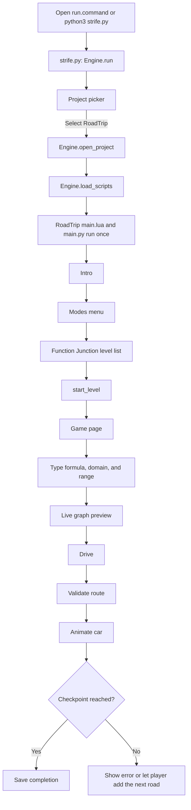
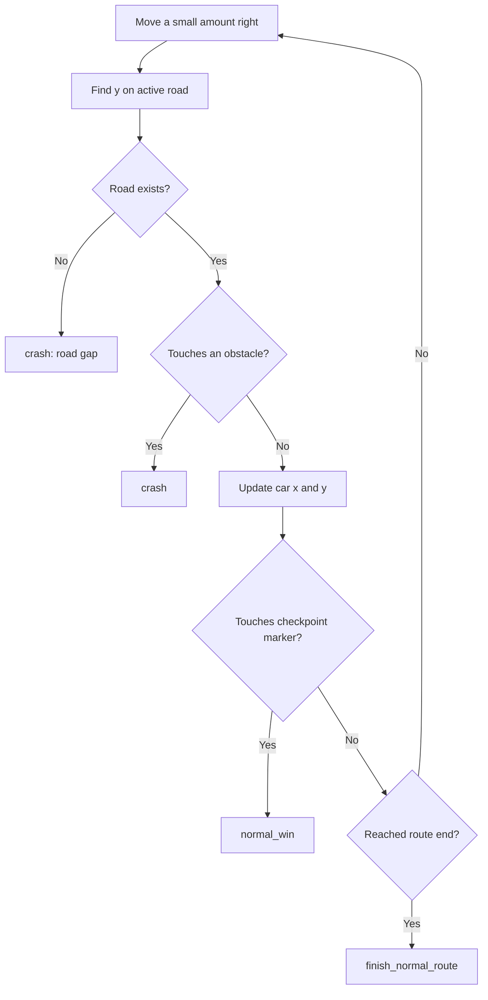

# MathHacks26 — Strife! and Function Junction

This repository contains **Strife!**, a small Python game engine, and its main educational game project, **Function Junction**. Players enter functions to draw a road, drive a car across the graph, avoid obstacles, and reach a checkpoint.

## Run the project

### macOS

Open [run.command](strife_game_engine/run.command). It activates the local virtual environment, builds the optional touchpad-pinch helper if needed, and starts Strife.

### Terminal

```bash
cd strife_game_engine
source .venv/bin/activate
python3 strife.py
```

Select **RoadTrip** in the project picker.

### Windows

```powershell
cd strife_game_engine
py -m venv .venv        # only needed once
.\.venv\Scripts\Activate.ps1
pip install raylib lupa # only needed once
py strife.py
```

## Repository map

```text
MathHacks26/
├── README.md                         # This guide
└── strife_game_engine/
    ├── run.command                   # macOS launcher
    ├── strife.py                     # Reusable engine
    └── projects/
        ├── RoadTrip/
        │   ├── scripts/main.py        # Function Junction and Endless mode
        │   ├── scripts/mathparse.py  # Safe expression parser
        │   ├── scripts/levels.py     # Normal-level data
        │   ├── scripts/main.lua      # Bomb Defusal mode
        │   ├── layouts/GameBD.json   # Bomb Defusal UI layout
        │   ├── assets/               # Images and animation frames
        │   └── save.json             # Local completion/settings data
        ├── MenuScreen/               # Example project
        └── demo/                     # Example project
```

## How the pieces fit together

There are two layers:

1. **Strife engine** opens the window, creates UI widgets, handles input, changes pages, loads scripts, and draws the screen.
2. **RoadTrip** uses those engine features to make a graphing game.



## 1. Strife starts the game

[strife.py](strife_game_engine/strife.py) is the engine entry point. Its final code creates an `Engine` and runs:

```python
eng.run()
```

`Engine.run()` creates a resizable Raylib window and starts the frame loop:

```python
while window_is_open:
    engine.update(delta_time)
    engine.draw()
```

`delta_time` is the time since the last frame. Using it makes movement speed consistent across computers.

### Engine APIs available to game scripts

| API | Purpose |
|---|---|
| `UI` | Create text, frames, buttons, inputs, and images. |
| `Page` | Switch between Intro, Menu, Game, and Bomb Defusal pages. |
| `Draw` | Draw the graph, grid, roads, markers, and custom visuals. |
| `Input` | Read mouse, dragging, mouse-wheel, and pinch gestures. |
| `Window` | Read the window size and toggle fullscreen. |
| `Storage` | Save completed levels. |
| `Tween` / `After` | Animate properties and schedule delayed work. |

When RoadTrip is selected, `Engine.open_project("RoadTrip")` points the engine to RoadTrip’s `scripts`, `assets`, `layouts`, and `save.json` folders. Then `Engine.load_scripts()` runs its Lua script and Python script, and saves their `on_update(dt)` and `on_draw()` functions to call every frame.

## 2. RoadTrip initializes

[main.py](strife_game_engine/projects/RoadTrip/scripts/main.py) runs top-to-bottom once when the project is loaded.

It imports the math parser and levels:

```python
from mathparse import parse, safe_eval
from levels import LEVELS
```

It then creates the most important state dictionaries:

| State | Stores |
|---|---|
| `S` | Current level, car position, active road, road history, current game mode, camera state, and messages. |
| `E` | Endless fuel, generated checkpoint, checkpoint count, Endless road history, and Endless obstacles. |

Next it creates widgets such as `UI.Button`, `UI.Input`, `UI.Text`, and `UI.Frame`, attaches their callbacks, calls `layout_window()`, and calls `start_intro()`.

`start_intro()` uses `After()` and `Tween()` for the title animation. After the animation, `show_main_menu()` opens RoadTrip’s modes menu.

## 3. Level selection

[levels.py](strife_game_engine/projects/RoadTrip/scripts/levels.py) stores every normal level as a dictionary:

```python
{
    "name": "1. Straight Road",
    "concept": "slope + intercept",
    "hint": "A line y = mx + b...",
    "start": (0, 1),
    "goal": (10, 4),
    "walls": [],
    "solution": "0.3x + 1",
}
```

The Function Junction page loops over `LEVELS` and makes one button per item. Clicking a level calls:

```python
start_level(level_number)
```

`start_level(i)` reads the level data, puts the car at `start`, clears old inputs, updates the title and hint, and opens the `Game` page.

## 4. Formula parsing

[mathparse.py](strife_game_engine/projects/RoadTrip/scripts/mathparse.py) safely turns the player’s text into a function that RoadTrip can call with an x-value.

```mermaid
flowchart LR
    A[Typed text: -0.2x^2 + 4] --> B[_tokenize]
    B --> C[_Parser]
    C --> D[parse]
    D --> E[Callable f(x)]
    E --> F[safe_eval]
```

### `_tokenize(text)`

This function cleans up friendly math notation and breaks it into tokens. For example:

- `×` becomes `*`
- `−` becomes `-`
- `x²` becomes `x^2`
- `y=` and `f(x)=` are removed from the beginning

### `_Parser`

The parser handles mathematical precedence: addition/subtraction, multiplication/division, signs, powers, and parentheses. It supports implicit multiplication, so `2x`, `3(x+1)`, and `x(x-4)` work.

Supported functions include `sin`, `cos`, `tan`, `sqrt`, `abs`, `ln`, `log`, and `exp`. Constants include `pi` and `e`.

### `safe_eval(f, x)`

`safe_eval()` catches math errors. A bad point, such as division by zero, becomes `None` instead of crashing the app.

## 5. Domains, ranges, and live preview

`parse_constraint(text, variable)` in `main.py` reads domains and ranges.

| Input | Meaning |
|---|---|
| `{xeR}` | All real x-values. |
| `{yeR}` | All real y-values. |
| `{xeR\|x>4}` | x must be greater than 4. |
| `{y=2}` | The only allowed output is y = 2. |
| `0<=x<=10` | x must be from 0 through 10. |
| `{y∈R\|1.5<y<3}` | y must be between 1.5 and 3. |

The result is a rule dictionary such as:

```python
{"lo": 0, "hi": 10, "kind": "finite"}
```

`inside(value, rule)` checks whether a coordinate belongs in that rule.

Every frame, `on_update(dt)` calls `refresh_curve()`. It tries to parse the current input with `preview_segments()` and samples the valid formula across the visible graph. `on_draw()` then draws those samples. This is why the road preview updates while the player types.

## 6. Pressing Drive

The Drive button is attached to:

```python
drive_btn.on_click = drive
```

For a normal level, `drive()` calls:

```python
build_normal_route()
```

which calls:

```python
build_route(S["start"], level["goal"][0], 1)
```

`build_route()` is the main validation function. It:

1. Reads the formula, domain, and range input fields.
2. Calls `parse()` for the formula.
3. Calls `parse_constraint()` for the domain and range.
4. Calls `marker_connection()` to ensure the graph touches the visible orange car marker box.
5. Calls `range_limited_end()` to find where the usable road ends.
6. Saves valid segments in `S["active"]`.

If validation fails, it raises `ValueError`. `drive()` catches that error and shows it with `set_msg()` in the footer.

## 7. Animation, collisions, and victory

After validation, `drive()` sets:

```python
S["mode"] = "driving"
```

Then every frame, `on_update(dt)` moves the car in small graph-space steps.



`hits_wall(x, y)` compares the car coordinate with the rectangles in the level’s `walls` list. `touches_marker(x, y, point)` uses the marker box size as a tolerance, so a graph only needs to touch the visible checkpoint box.

When the car reaches the checkpoint, `normal_win()` changes the game state to `won`, displays the success message, and stores the completed level using `Storage.Load()` and `Storage.Save()`.

## 8. Drawing order

RoadTrip’s custom `on_draw()` renders:

1. Graph background
2. Grid and axes
3. Red dotted obstacle boxes
4. Road lines
5. Green checkpoint marker and flag
6. Orange car marker and car

Road behind the car is green. Road ahead remains blue.

## 9. Endless Road

`start_endless()` resets Endless mode with 100 fuel, a car at `(0, 0)`, and a generated checkpoint.

`drive_endless()` uses the same route-building logic as normal levels, but charges fuel according to the entered domains. Successful roads become part of `E["history"]`, so they stay visible for the rest of the run.

When a checkpoint is reached, `reach_endless_checkpoint()` gives 30 fuel, generates the next checkpoint farther right, and adds an obstacle every three checkpoints.

## 10. Bomb Defusal

[main.lua](strife_game_engine/projects/RoadTrip/scripts/main.lua) contains Bomb Defusal mode. It uses the same Strife APIs, but it is written in Lua. [GameBD.json](strife_game_engine/projects/RoadTrip/layouts/GameBD.json) stores its UI layout.

This shows that a Strife project can use both Python and Lua scripts.

## 11. Add a normal level

Add another dictionary to `LEVELS` in [levels.py](strife_game_engine/projects/RoadTrip/scripts/levels.py):

```python
{
    "name": "11. Gentle Climb",
    "concept": "linear functions",
    "hint": "Use a line that starts at the car and reaches the flag.",
    "start": (0, 1),
    "goal": (12, 4),
    "walls": [(5, -1, 6, 2)],
    "solution": "0.25x + 1",
},
```

Coordinates use graph units. A wall is `(left_x, bottom_y, right_x, top_y)`. The level menu is generated from `LEVELS`, so the new level appears automatically after a reload.

## 12. Debugging map

| Symptom | Start here |
|---|---|
| Strife will not open | `run.command`, environment setup, then `strife.py`. |
| Project picker issue | `Engine.build_hub()` in `strife.py`. |
| Menu or layout issue | `main.py` setup and `layout_window()`. |
| Formula is rejected | `mathparse.py` and `parse_constraint()`. |
| Preview is wrong | `preview_segments()`, `refresh_curve()`, `on_draw()`. |
| Road refuses to begin | `marker_connection()` and `build_route()`. |
| Car crashes or misses the flag | `on_update()`, `hits_wall()`, `touches_marker()`. |
| Level coordinates are wrong | `levels.py`. |
| Endless fuel or checkpoints are wrong | `start_endless()`, `drive_endless()`, `reach_endless_checkpoint()`. |

## Judge walkthrough summary

```text
run.command
→ strife.py creates the engine window
→ project picker opens RoadTrip
→ RoadTrip main.py creates pages and callbacks
→ levels.py supplies the selected level data
→ mathparse.py safely turns text into f(x)
→ build_route validates formula, domain, range, and marker connection
→ on_update animates the car and checks collisions/checkpoints
→ normal_win saves completion
```
